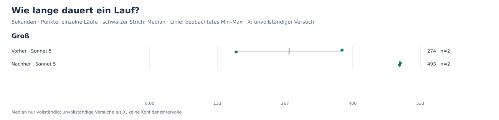
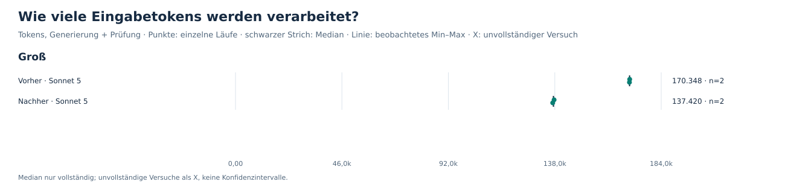
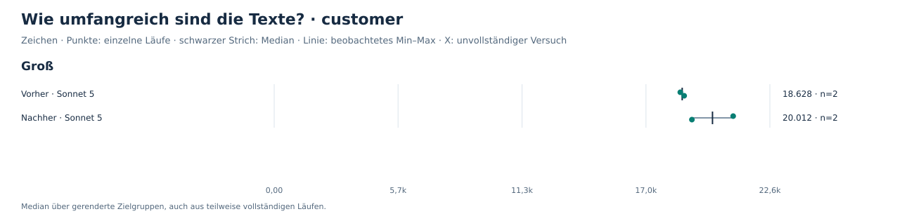
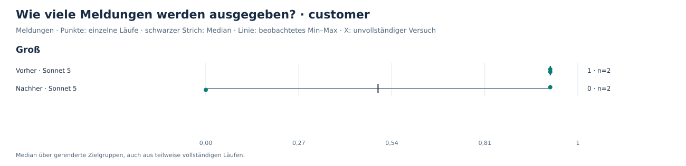

# Änderung #338: vorher und nachher

Automatisch erzeugt durch `tools/sweep_results.py`; nicht von Hand bearbeiten.
Lokale Auswertung vorhandener Messergebnisse, ohne Modellaufrufe und ohne Judging.

10 Versuche; 4 vollständig; 0 teilweise vollständig; 6 ohne Run-Record.

## Beobachtungen

- Groß: 4 von 10 Versuchen vollständig.
- Vorher und nachher haben jeweils zwei vollständige Läufe, unterschiedliche Chartula-Commits und unterschiedliche Prompt-Hashes.
- Sechs weitere Versuchsfolder haben keinen Run-Record; ihre Dauer und Kosten bleiben unbekannt.
- Eine historische Preistabelle für claude-sonnet-5 fehlt in diesen Sweep-Daten; deshalb erscheinen keine Kostencharts.

## 1. Vollständigkeit

Jedes Quadrat steht für einen Versuch; auch Fehlversuche und fehlende Records bleiben sichtbar.

## 3. Wartezeit

Gesamtdauer inklusive Arbeit außerhalb der Modellphasen. Fehlende Dauer wird nicht als null ersetzt.

## 5. Eingabemenge

Tokens hängen auch vom Tokenizer ab. Vergleiche zwischen Anbietern sind keine direkte Messung der Informationsmenge.

## Textumfang · customer

Zeichen im gespeicherten Rendering, einschließlich Markdown. Länge und Zahl der Einträge messen keine Qualität oder Faktenabdeckung.

## Prüfermeldungen · customer

Eine Meldung ist keine bestätigte falsche Aussage. Weniger Meldungen können ebenso aus weniger Text oder einem anderen Prüfverhalten entstehen.

## Wiederkehrende Meldungen · customer

Gezählt wird, welche PR in derselben Zielgruppe wiederholt Meldungen erhält. Die Begründung kann sich zwischen Läufen unterscheiden; Meldungen ohne PR-Zuordnung sind hier ausgeschlossen.

## Zahlen

| Szenario | Konfiguration | vollständig | Median USD ohne Cache | Median Sekunden | Cachekosten aller Versuche | Ausgaben / vollständige Läufe |
| --- | --- | --- | --- | --- | --- | --- |
| Groß | Vorher · Sonnet 5 | 2/6 | unbekannt | 274,5 | unbekannt | unbekannt |
| Groß | Nachher · Sonnet 5 | 2/4 | unbekannt | 492,8 | unbekannt | unbekannt |

Ausgaben / vollständige Läufe zählt alle Versuche, auch unvollständige und fehlgeschlagene.
Bei unbekannten Kosten oder null vollständigen Läufen bleibt die Kennzahl unbekannt.

## Konfigurationen

| Konfiguration | Generierung | Thinking | Prüfung | Check-Thinking | Faktentiefe |
| --- | --- | --- | --- | --- | --- |
| Vorher · Sonnet 5 | claude-sonnet-5 | provider-default | claude-sonnet-5 | provider-default | title-and-description |
| Nachher · Sonnet 5 | claude-sonnet-5 | provider-default | claude-sonnet-5 | provider-default | title-and-description |

## Grenzen und Methodik

- Die Ergebnisse beschreiben diese Releases und Einstellungen; sie sind keine allgemeine Modellrangliste.
- Einzelwerte und beobachtete Spannweiten zeigen Wiederholungen am selben Release, keine Konfidenzintervalle.
- Kosten mit fehlenden Nutzungsangaben sind Untergrenzen, falls costIsLowerBound gesetzt ist; daraus folgt kein vollständiger Gesamtpreis.
- Die Texte werden pro Konfiguration neu erzeugt; Prüferunterschiede können hier nicht isoliert werden.
- Judging und Rubriken bleiben eingefroren; es werden keine Qualitätsurteile erzeugt.
- Faktische Korrektheit, Vollständigkeit der Aussagen und Nachbearbeitungsaufwand wurden hier nicht bewertet.
- Kosten nach Cache sind anhand gespeicherter Nutzung und historischer Preise berechnet, nicht anhand einer Rechnung verifiziert.
- Pro Zielgruppe werden auch Texte teilweise vollständiger Läufe berücksichtigt; fehlende Texte sind keine leeren Texte.
- Lokale Arbeitsfassung: keine Rohtexte, Meldungsbegründungen oder Schlüsselkennungen im Export; Repository- und PR-Metadaten vor öffentlicher Veröffentlichung prüfen.

## Daten

- `runs.csv`: alle Versuche, fehlende Messwerte bleiben leer.
- `configurations.csv`: Zusammenfassung mit definierten Nennern.
- `flag-overlap.csv`: Meldungswiederholung je PR und Zielgruppe.
- `data-issues.csv`: fehlende Records, Preise und widersprüchliche Metadaten.
