# Oktober 2026: vier reale Szenarien

Automatisch erzeugt durch `tools/sweep_results.py`; nicht von Hand bearbeiten.
Lokale Auswertung vorhandener Messergebnisse, ohne Modellaufrufe und ohne Judging.

84 Versuche; 74 vollständig; 10 teilweise vollständig; 0 ohne Run-Record.

## Beobachtungen

- Klein: 17 von 18 Versuchen vollständig.
- Typisch: 22 von 24 Versuchen vollständig.
- Groß: 18 von 18 Versuchen vollständig.
- Schwierige Quelldaten: 17 von 24 Versuchen vollständig.
- Im schwierigen Fall liefern OpenAI G-G und G-M jeweils keinen vollständigen Lauf von drei Versuchen.
- Die Premiumkonfigurationen P-M sind nur für typisch und schwierig gemessen; für klein und groß fehlen Messungen.
- Toolversion, Prompt, Faktentiefe und Thorough-Einstellung stimmen über die Records überein; Fakten und Release-Commits stimmen innerhalb jedes Szenarios überein.
- Klein, unter den Konfigurationen mit 3/3 vollständigen Läufen: niedrigster Kostenmedian OpenAI G-G (0,0028 USD); niedrigster Laufzeitmedian OpenAI G-G (13,9 s).
- Typisch, unter den Konfigurationen mit 3/3 vollständigen Läufen: niedrigster Kostenmedian OpenAI G-G (0,0055 USD); niedrigster Laufzeitmedian OpenAI G-G (29,5 s).
- Groß, unter den Konfigurationen mit 3/3 vollständigen Läufen: niedrigster Kostenmedian OpenAI G-G (0,0155 USD); niedrigster Laufzeitmedian Anthropic G-M (56,0 s).
- Schwierige Quelldaten, unter den Konfigurationen mit 3/3 vollständigen Läufen: niedrigster Kostenmedian Anthropic G-M (0,0119 USD); niedrigster Laufzeitmedian Anthropic G-M (16,9 s).
- Diese Mediane beschreiben drei Wiederholungen; kleine Abstände sind keine belastbare Überlegenheit.

## 1. Vollständigkeit

Jedes Quadrat steht für einen Versuch; auch Fehlversuche und fehlende Records bleiben sichtbar.

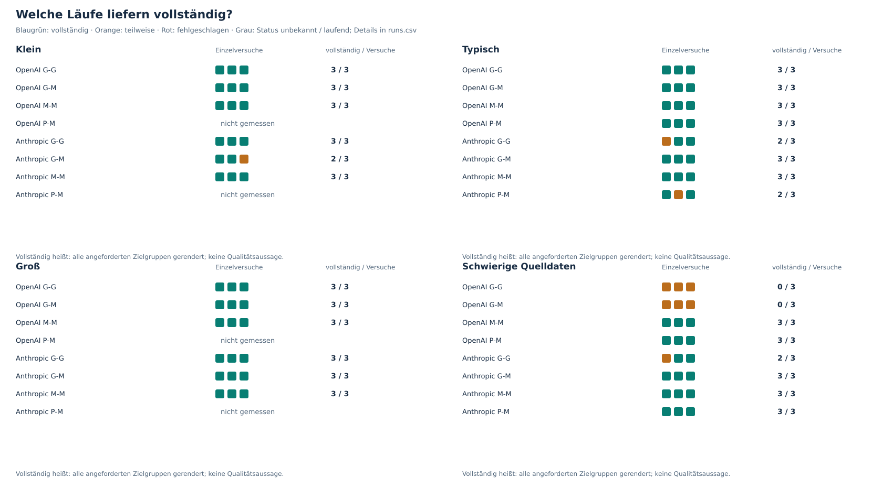

## 2. API-Kosten

Historische Listenpreise ohne Cache; der Median bezieht sich auf vollständige Läufe. Orange Kreuze zeigen bekannte Ausgaben unvollständiger Versuche.

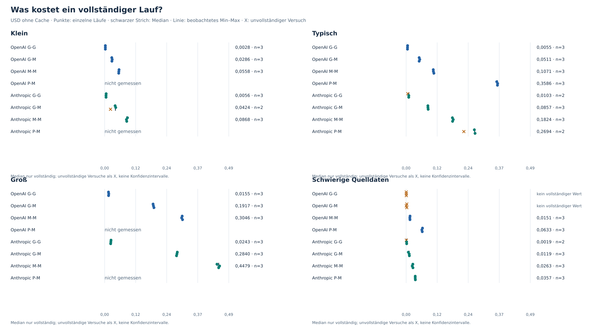

## 3. Wartezeit

Gesamtdauer inklusive Arbeit außerhalb der Modellphasen. Fehlende Dauer wird nicht als null ersetzt.

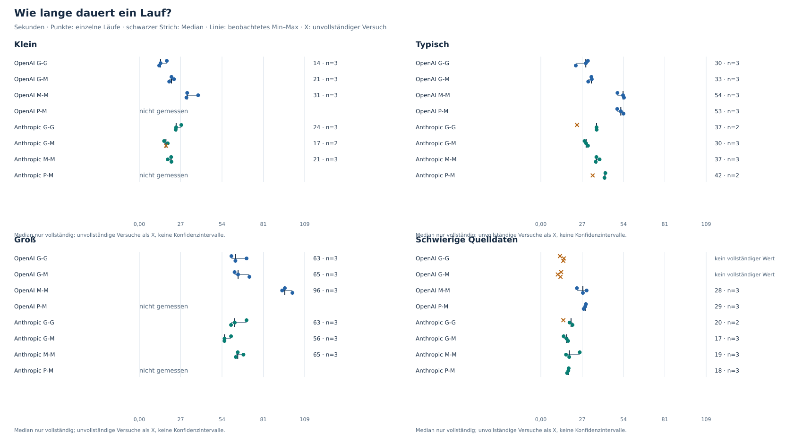

## 4. Kosten von Generierung und Prüfung

Arithmetische Mittelwerte vollständiger Läufe; die Phasen sind deshalb addierbar. Nicht die Summe unabhängiger Phasenmediane.

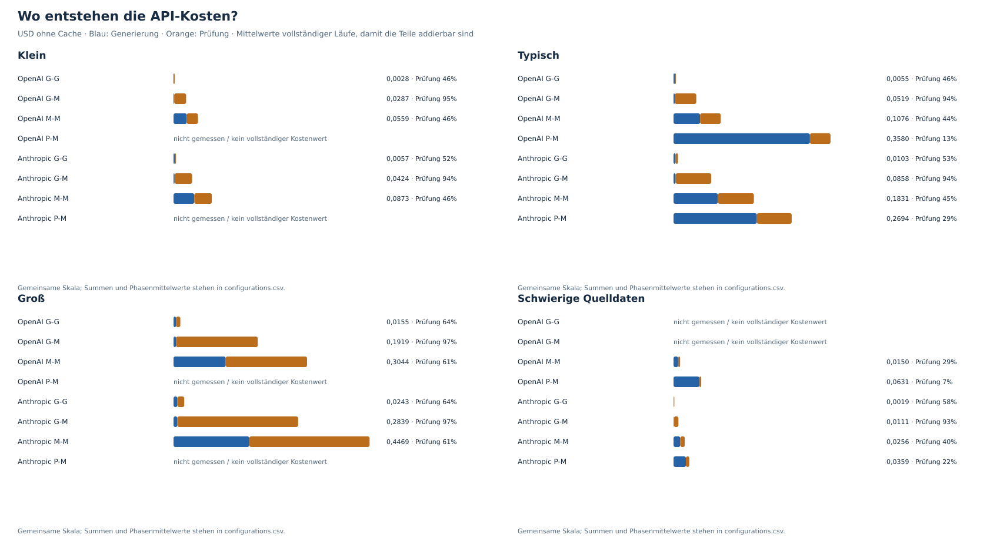

## 5. Eingabemenge

Tokens hängen auch vom Tokenizer ab. Vergleiche zwischen Anbietern sind keine direkte Messung der Informationsmenge.

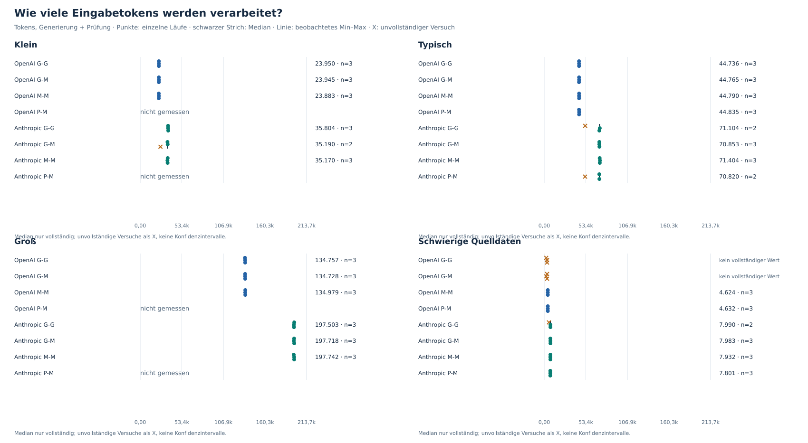

## Textumfang · technical

Zeichen im gespeicherten Rendering, einschließlich Markdown. Länge und Zahl der Einträge messen keine Qualität oder Faktenabdeckung.

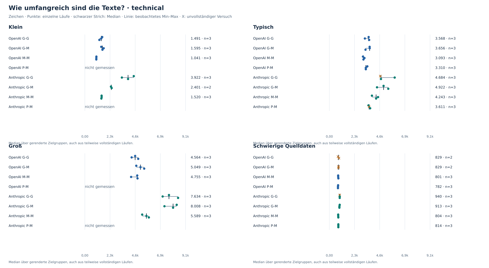

## Prüfermeldungen · technical

Eine Meldung ist keine bestätigte falsche Aussage. Weniger Meldungen können ebenso aus weniger Text oder einem anderen Prüfverhalten entstehen.

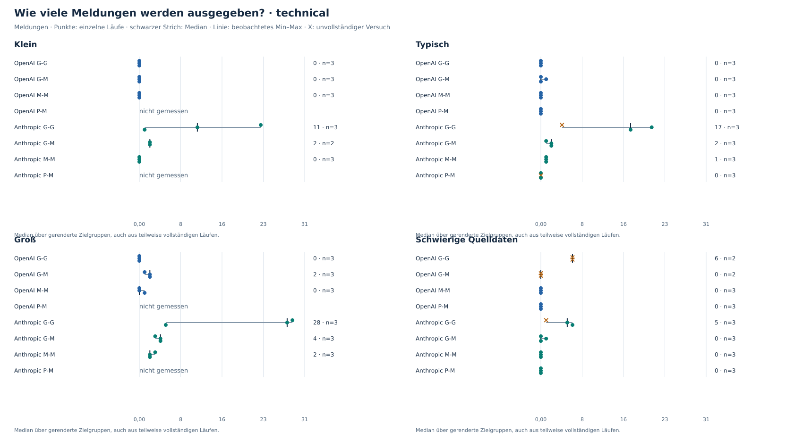

## Wiederkehrende Meldungen · technical

Gezählt wird, welche PR in derselben Zielgruppe wiederholt Meldungen erhält. Die Begründung kann sich zwischen Läufen unterscheiden; Meldungen ohne PR-Zuordnung sind hier ausgeschlossen.

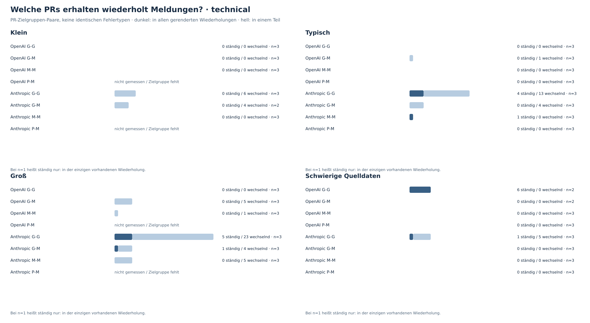

## Textumfang · customer

Zeichen im gespeicherten Rendering, einschließlich Markdown. Länge und Zahl der Einträge messen keine Qualität oder Faktenabdeckung.

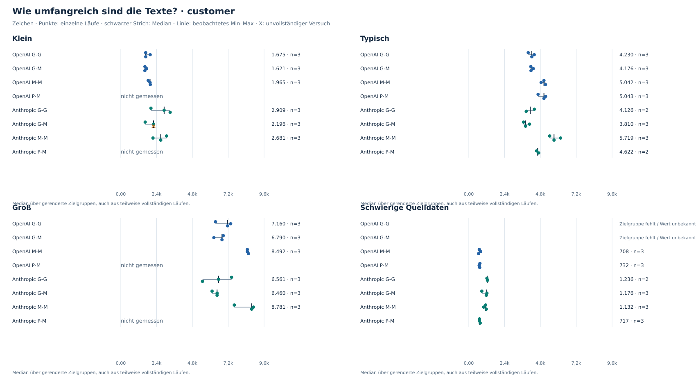

## Prüfermeldungen · customer

Eine Meldung ist keine bestätigte falsche Aussage. Weniger Meldungen können ebenso aus weniger Text oder einem anderen Prüfverhalten entstehen.

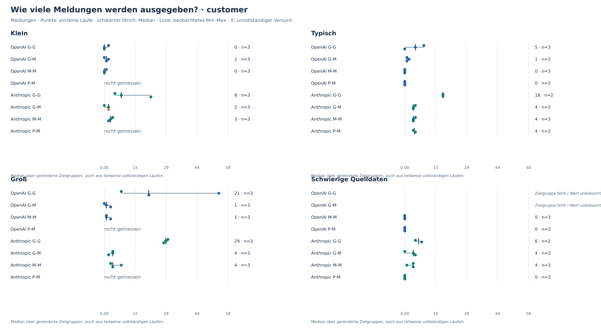

## Wiederkehrende Meldungen · customer

Gezählt wird, welche PR in derselben Zielgruppe wiederholt Meldungen erhält. Die Begründung kann sich zwischen Läufen unterscheiden; Meldungen ohne PR-Zuordnung sind hier ausgeschlossen.

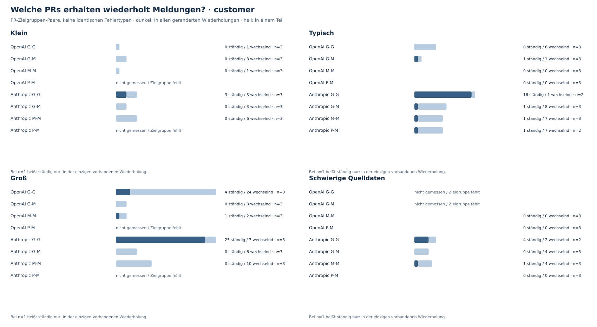

## Kosten und Wartezeit

Nur vollständige Läufe; die Legende nennt zusätzlich die Abschlussquote. Eine schnelle oder günstige Konfiguration ist damit noch keine gute Textkonfiguration.

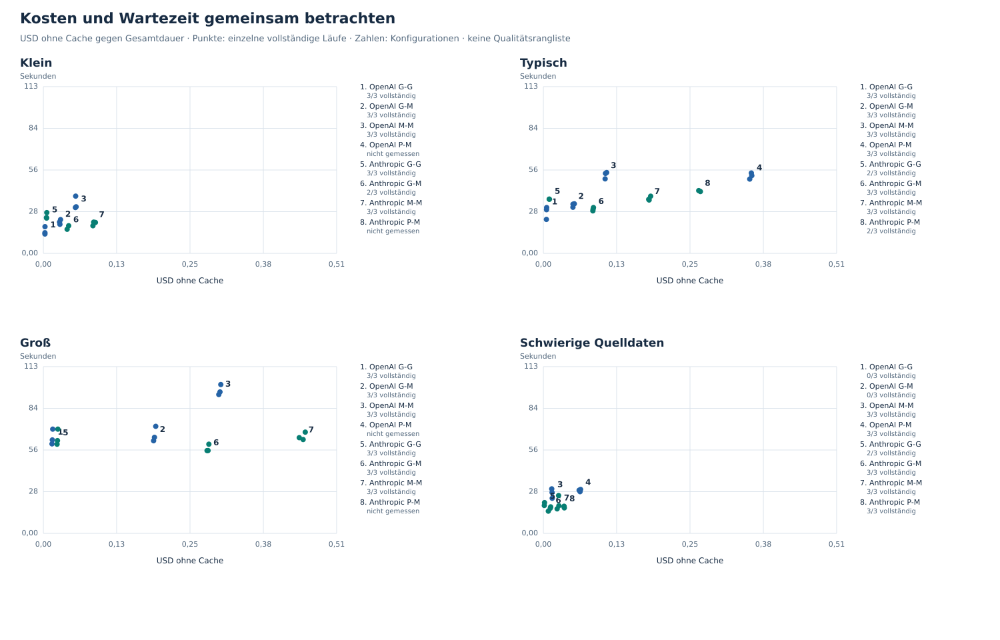

## Zahlen

| Szenario | Konfiguration | vollständig | Median USD ohne Cache | Median Sekunden | Cachekosten aller Versuche | Ausgaben / vollständige Läufe |
| --- | --- | --- | --- | --- | --- | --- |
| Schwierige Quelldaten | Anthropic G-G | 2/3 | 0,0019 | 19,8 | 0,0047 | 0,0024 |
| Schwierige Quelldaten | Anthropic G-M | 3/3 | 0,0119 | 16,9 | 0,0333 | 0,0111 |
| Schwierige Quelldaten | Anthropic M-M | 3/3 | 0,0263 | 18,7 | 0,0769 | 0,0256 |
| Schwierige Quelldaten | Anthropic P-M | 3/3 | 0,0357 | 18,1 | 0,1076 | 0,0359 |
| Schwierige Quelldaten | OpenAI G-G | 0/3 | unbekannt | unbekannt | 0,0015 | unbekannt |
| Schwierige Quelldaten | OpenAI G-M | 0/3 | unbekannt | unbekannt | 0,0052 | unbekannt |
| Schwierige Quelldaten | OpenAI M-M | 3/3 | 0,0151 | 27,6 | 0,0384 | 0,0128 |
| Schwierige Quelldaten | OpenAI P-M | 3/3 | 0,0633 | 29,1 | 0,1570 | 0,0523 |
| Groß | Anthropic G-G | 3/3 | 0,0243 | 62,7 | 0,0730 | 0,0243 |
| Groß | Anthropic G-M | 3/3 | 0,2840 | 56,0 | 0,8518 | 0,2839 |
| Groß | Anthropic M-M | 3/3 | 0,4479 | 64,7 | 1,3408 | 0,4469 |
| Groß | OpenAI G-G | 3/3 | 0,0155 | 63,1 | 0,0424 | 0,0141 |
| Groß | OpenAI G-M | 3/3 | 0,1917 | 64,9 | 0,5638 | 0,1879 |
| Groß | OpenAI M-M | 3/3 | 0,3046 | 95,6 | 0,8239 | 0,2746 |
| Klein | Anthropic G-G | 3/3 | 0,0056 | 24,2 | 0,0171 | 0,0057 |
| Klein | Anthropic G-M | 2/3 | 0,0424 | 17,5 | 0,1077 | 0,0538 |
| Klein | Anthropic M-M | 3/3 | 0,0868 | 20,9 | 0,2620 | 0,0873 |
| Klein | OpenAI G-G | 3/3 | 0,0028 | 13,9 | 0,0063 | 0,0021 |
| Klein | OpenAI G-M | 3/3 | 0,0286 | 21,1 | 0,0830 | 0,0277 |
| Klein | OpenAI M-M | 3/3 | 0,0558 | 31,4 | 0,1234 | 0,0411 |
| Typisch | Anthropic G-G | 2/3 | 0,0103 | 36,6 | 0,0273 | 0,0136 |
| Typisch | Anthropic G-M | 3/3 | 0,0857 | 29,8 | 0,2575 | 0,0858 |
| Typisch | Anthropic M-M | 3/3 | 0,1824 | 36,5 | 0,5493 | 0,1831 |
| Typisch | Anthropic P-M | 2/3 | 0,2694 | 42,1 | 0,7655 | 0,3827 |
| Typisch | OpenAI G-G | 3/3 | 0,0055 | 29,5 | 0,0124 | 0,0041 |
| Typisch | OpenAI G-M | 3/3 | 0,0511 | 33,2 | 0,1498 | 0,0499 |
| Typisch | OpenAI M-M | 3/3 | 0,1071 | 54,0 | 0,2370 | 0,0790 |
| Typisch | OpenAI P-M | 3/3 | 0,3586 | 52,5 | 0,6678 | 0,2226 |

Ausgaben / vollständige Läufe zählt alle Versuche, auch unvollständige und fehlgeschlagene.
Bei unbekannten Kosten oder null vollständigen Läufen bleibt die Kennzahl unbekannt.

## Konfigurationen

| Konfiguration | Generierung | Thinking | Prüfung | Check-Thinking | Faktentiefe |
| --- | --- | --- | --- | --- | --- |
| OpenAI G-G | gpt-6-luna | disabled | gpt-6-luna | disabled | title-and-description |
| OpenAI G-M | gpt-6-luna | disabled | gpt-6.1-sol | low | title-and-description |
| OpenAI M-M | gpt-6.1-sol | low | gpt-6.1-sol | low | title-and-description |
| OpenAI P-M | gpt-6-astra | low | gpt-6.1-sol | low | title-and-description |
| Anthropic G-G | claude-haiku-5-5 | disabled | claude-haiku-5-5 | disabled | title-and-description |
| Anthropic G-M | claude-haiku-5-5 | disabled | claude-sonnet-5-5 | low | title-and-description |
| Anthropic M-M | claude-sonnet-5-5 | low | claude-sonnet-5-5 | low | title-and-description |
| Anthropic P-M | claude-opus-5-5 | low | claude-sonnet-5-5 | low | title-and-description |

## Grenzen und Methodik

- Die Ergebnisse beschreiben diese Releases und Einstellungen; sie sind keine allgemeine Modellrangliste.
- Einzelwerte und beobachtete Spannweiten zeigen Wiederholungen am selben Release, keine Konfidenzintervalle.
- Kosten mit fehlenden Nutzungsangaben sind Untergrenzen, falls costIsLowerBound gesetzt ist; daraus folgt kein vollständiger Gesamtpreis.
- Die Texte werden pro Konfiguration neu erzeugt; Prüferunterschiede können hier nicht isoliert werden.
- Judging und Rubriken bleiben eingefroren; es werden keine Qualitätsurteile erzeugt.
- Faktische Korrektheit, Vollständigkeit der Aussagen und Nachbearbeitungsaufwand wurden hier nicht bewertet.
- Kosten nach Cache sind anhand gespeicherter Nutzung und historischer Preise berechnet, nicht anhand einer Rechnung verifiziert.
- Pro Zielgruppe werden auch Texte teilweise vollständiger Läufe berücksichtigt; fehlende Texte sind keine leeren Texte.
- Lokale Arbeitsfassung: keine Rohtexte, Meldungsbegründungen oder Schlüsselkennungen im Export; Repository- und PR-Metadaten vor öffentlicher Veröffentlichung prüfen.

## Daten

- `runs.csv`: alle Versuche, fehlende Messwerte bleiben leer.
- `configurations.csv`: Zusammenfassung mit definierten Nennern.
- `flag-overlap.csv`: Meldungswiederholung je PR und Zielgruppe.
- `data-issues.csv`: fehlende Records, Preise und widersprüchliche Metadaten.
