# September 2026: Einstellungen an ServiceDeskLite

Automatisch erzeugt durch `tools/sweep_results.py`; nicht von Hand bearbeiten.
Lokale Auswertung vorhandener Messergebnisse, ohne Modellaufrufe und ohne Judging.

43 Versuche; 42 vollständig; 0 teilweise vollständig; 0 ohne Run-Record.

## Beobachtungen

- Typisch: 42 von 43 Versuchen vollständig.
- Vierzehn Konfigurationen haben jeweils drei vollständige Läufe; zusätzlich bleibt ein fehlgeschlagener Versuch sichtbar.
- Thinking, Prüfmodell, Thorough an/aus und Faktentiefe sind eigene Versuche an einem Release; ihre Wirkung wird nicht mit anderen Chartula-Versionen vermischt.
- Lokale Modelle haben in der Preistabelle null API-Kosten; Hardware, Energie und Betrieb sind nicht eingerechnet.
- gpt-6-luna, Thinking aus → hoch: Kostenmedian 0,0512 → 0,0552 USD; Laufzeitmedian 32,0 → 128,4 Sekunden.
- gpt-6-sol, Thinking aus → hoch: Kostenmedian 0,1048 → 0,1701 USD; Laufzeitmedian 40,2 → 170,3 Sekunden.

## 1. Vollständigkeit

Jedes Quadrat steht für einen Versuch; auch Fehlversuche und fehlende Records bleiben sichtbar.

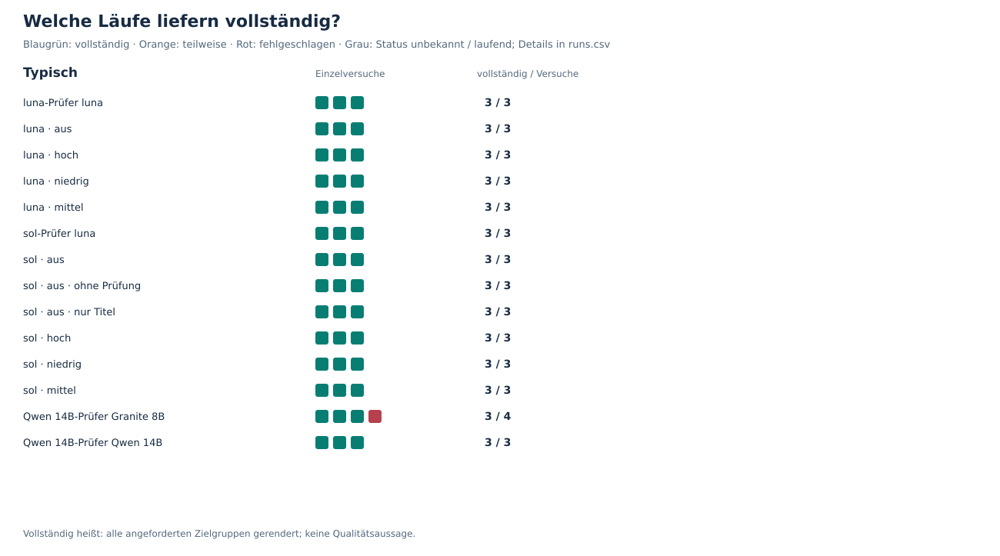

## 2. API-Kosten

Historische Listenpreise ohne Cache; der Median bezieht sich auf vollständige Läufe. Orange Kreuze zeigen bekannte Ausgaben unvollständiger Versuche.

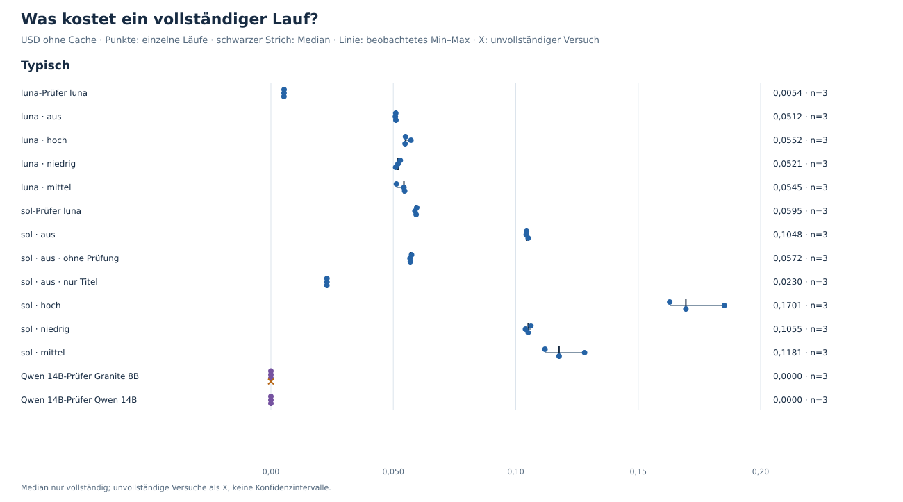

## 3. Wartezeit

Gesamtdauer inklusive Arbeit außerhalb der Modellphasen. Fehlende Dauer wird nicht als null ersetzt.

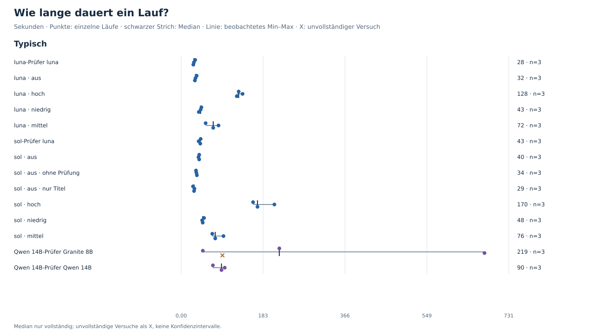

## 4. Kosten von Generierung und Prüfung

Arithmetische Mittelwerte vollständiger Läufe; die Phasen sind deshalb addierbar. Nicht die Summe unabhängiger Phasenmediane.

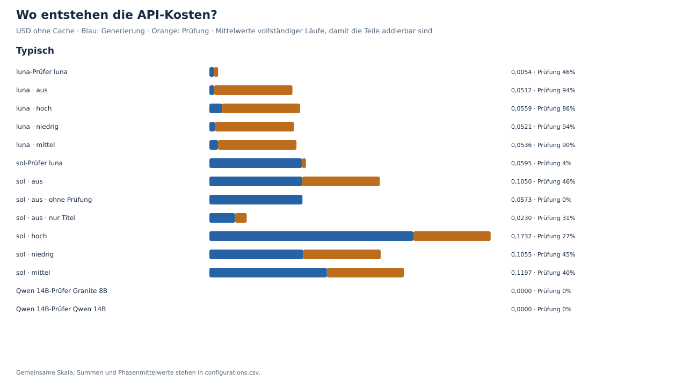

## Thinking-Stufen im direkten Vergleich

Nur die acht Konfigurationen mit festem gpt-6-sol-Prüfer, gleicher Faktentiefe und aktivem Thorough Check. Drei Wiederholungen je Stufe.

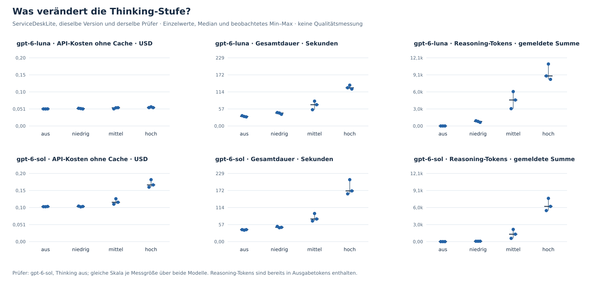

## Faktentiefe und Thorough Check: Kosten

Referenz: sol ohne Thinking. Jeweils wird nur Thorough abgeschaltet oder auf Titel als Faktentiefe gewechselt; Auswirkungen auf Qualität sind nicht bewertet.

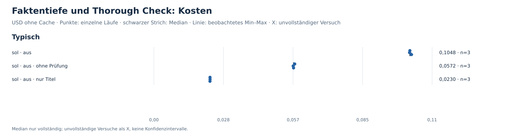

## Faktentiefe und Thorough Check: Wartezeit

Referenz: sol ohne Thinking. Jeweils wird nur Thorough abgeschaltet oder auf Titel als Faktentiefe gewechselt; Auswirkungen auf Qualität sind nicht bewertet.

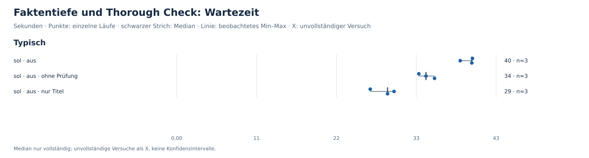

## Faktentiefe und Thorough Check: Eingabetokens

Referenz: sol ohne Thinking. Jeweils wird nur Thorough abgeschaltet oder auf Titel als Faktentiefe gewechselt; Auswirkungen auf Qualität sind nicht bewertet.

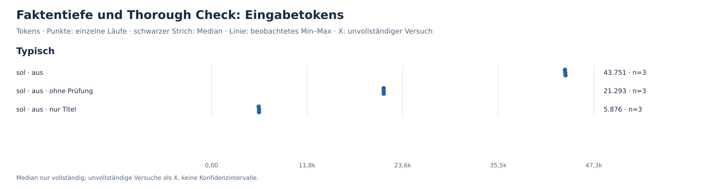

## 5. Eingabemenge

Tokens hängen auch vom Tokenizer ab. Vergleiche zwischen Anbietern sind keine direkte Messung der Informationsmenge.

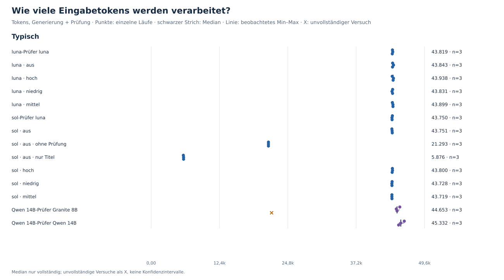

## Textumfang · technical

Zeichen im gespeicherten Rendering, einschließlich Markdown. Länge und Zahl der Einträge messen keine Qualität oder Faktenabdeckung.

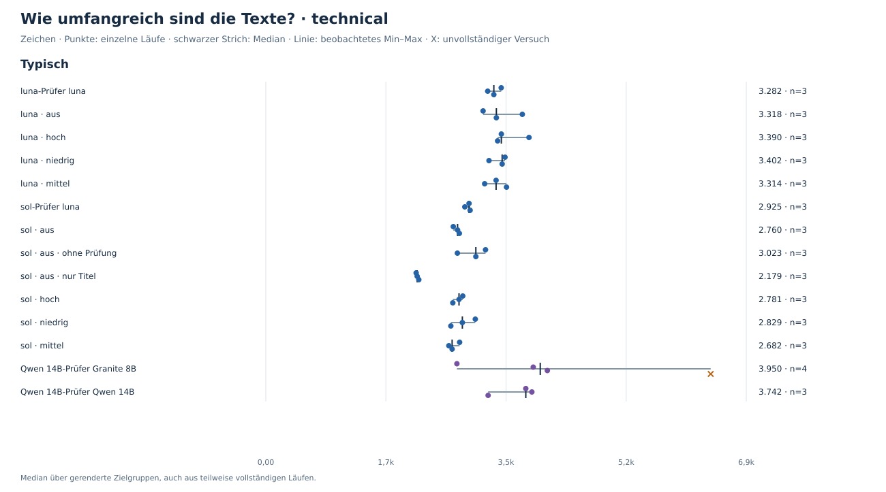

## Prüfermeldungen · technical

Eine Meldung ist keine bestätigte falsche Aussage. Weniger Meldungen können ebenso aus weniger Text oder einem anderen Prüfverhalten entstehen.

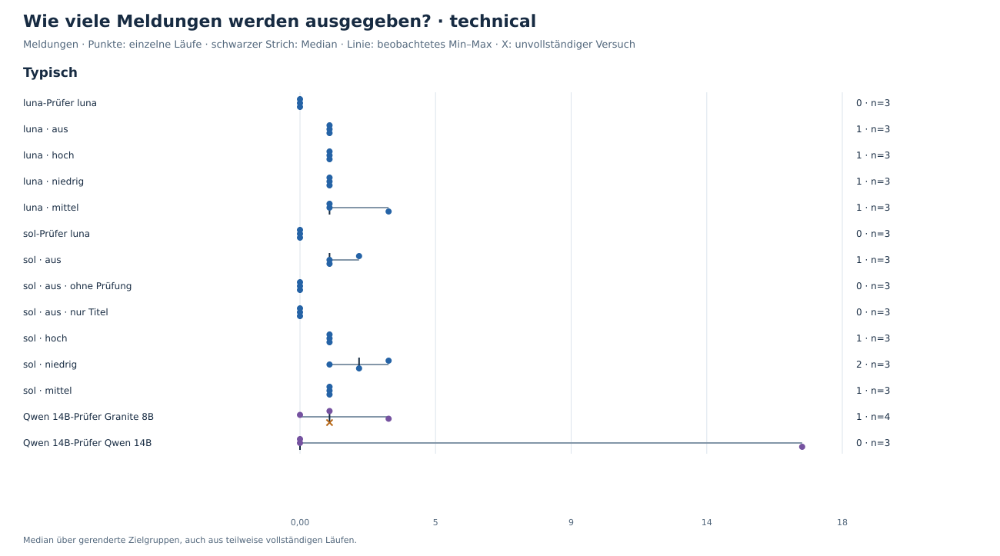

## Wiederkehrende Meldungen · technical

Gezählt wird, welche PR in derselben Zielgruppe wiederholt Meldungen erhält. Die Begründung kann sich zwischen Läufen unterscheiden; Meldungen ohne PR-Zuordnung sind hier ausgeschlossen.

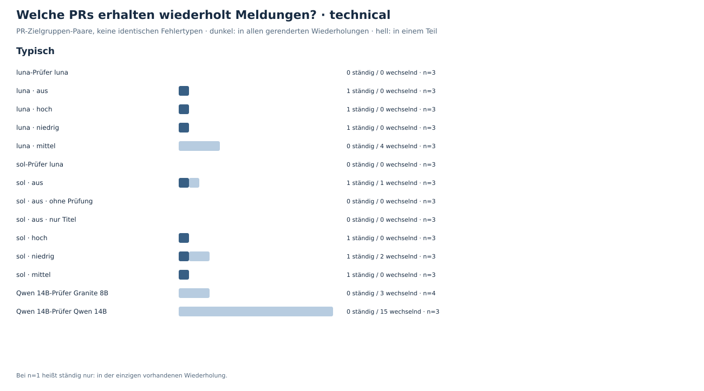

## Textumfang · customer

Zeichen im gespeicherten Rendering, einschließlich Markdown. Länge und Zahl der Einträge messen keine Qualität oder Faktenabdeckung.

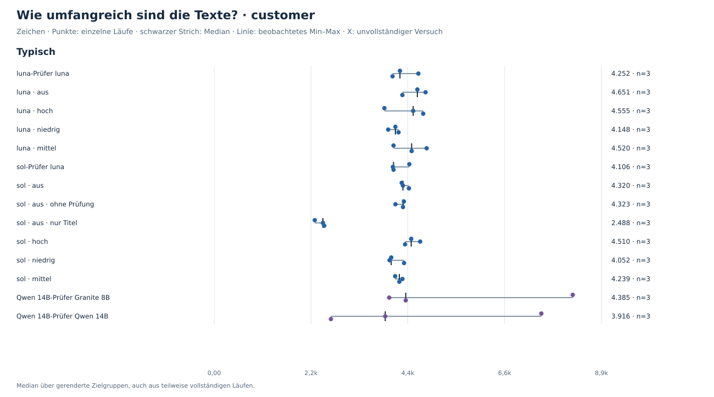

## Prüfermeldungen · customer

Eine Meldung ist keine bestätigte falsche Aussage. Weniger Meldungen können ebenso aus weniger Text oder einem anderen Prüfverhalten entstehen.

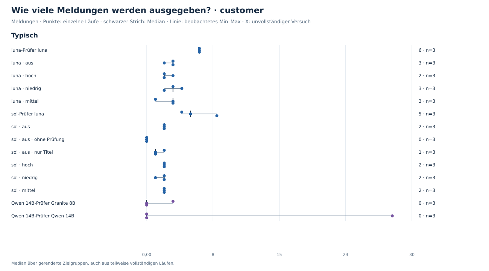

## Wiederkehrende Meldungen · customer

Gezählt wird, welche PR in derselben Zielgruppe wiederholt Meldungen erhält. Die Begründung kann sich zwischen Läufen unterscheiden; Meldungen ohne PR-Zuordnung sind hier ausgeschlossen.

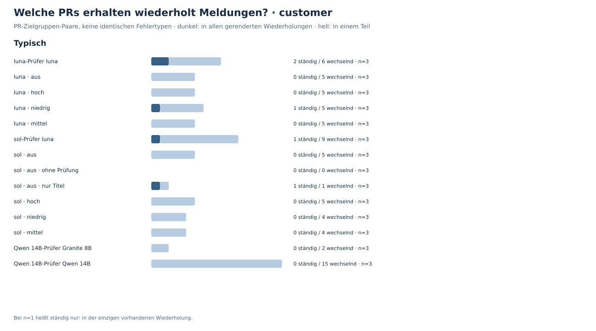

## Kosten und Wartezeit

Nur vollständige Läufe; die Legende nennt zusätzlich die Abschlussquote. Eine schnelle oder günstige Konfiguration ist damit noch keine gute Textkonfiguration.

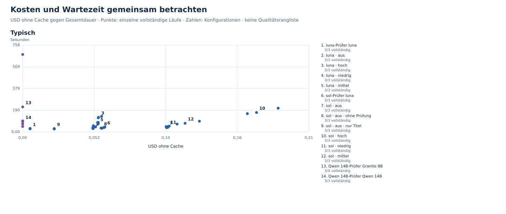

## Zahlen

| Szenario | Konfiguration | vollständig | Median USD ohne Cache | Median Sekunden | Cachekosten aller Versuche | Ausgaben / vollständige Läufe |
| --- | --- | --- | --- | --- | --- | --- |
| Typisch | luna-Prüfer luna | 3/3 | 0,0054 | 28,4 | 0,0123 | 0,0041 |
| Typisch | luna · aus | 3/3 | 0,0512 | 32,0 | 0,1496 | 0,0499 |
| Typisch | luna · hoch | 3/3 | 0,0552 | 128,4 | 0,1638 | 0,0546 |
| Typisch | luna · niedrig | 3/3 | 0,0521 | 43,4 | 0,1525 | 0,0508 |
| Typisch | luna · mittel | 3/3 | 0,0545 | 71,5 | 0,1570 | 0,0523 |
| Typisch | sol-Prüfer luna | 3/3 | 0,0595 | 42,7 | 0,1018 | 0,0339 |
| Typisch | sol · aus | 3/3 | 0,1048 | 40,2 | 0,2383 | 0,0794 |
| Typisch | sol · aus · ohne Prüfung | 3/3 | 0,0572 | 33,9 | 0,0569 | 0,0190 |
| Typisch | sol · aus · nur Titel | 3/3 | 0,0230 | 28,7 | 0,0594 | 0,0198 |
| Typisch | sol · hoch | 3/3 | 0,1701 | 170,3 | 0,4429 | 0,1476 |
| Typisch | sol · niedrig | 3/3 | 0,1055 | 48,1 | 0,2398 | 0,0799 |
| Typisch | sol · mittel | 3/3 | 0,1181 | 76,0 | 0,2825 | 0,0942 |
| Typisch | Qwen 14B-Prüfer Granite 8B | 3/4 | 0,0000 | 219,1 | 0,0000 | 0,0000 |
| Typisch | Qwen 14B-Prüfer Qwen 14B | 3/3 | 0,0000 | 90,0 | 0,0000 | 0,0000 |

Ausgaben / vollständige Läufe zählt alle Versuche, auch unvollständige und fehlgeschlagene.
Bei unbekannten Kosten oder null vollständigen Läufen bleibt die Kennzahl unbekannt.

## Konfigurationen

| Konfiguration | Generierung | Thinking | Prüfung | Check-Thinking | Faktentiefe |
| --- | --- | --- | --- | --- | --- |
| luna-Prüfer luna | gpt-6-luna | disabled | gpt-6-luna | disabled | title-and-description |
| luna · aus | gpt-6-luna | disabled | gpt-6-sol | disabled | title-and-description |
| luna · hoch | gpt-6-luna | high | gpt-6-sol | disabled | title-and-description |
| luna · niedrig | gpt-6-luna | low | gpt-6-sol | disabled | title-and-description |
| luna · mittel | gpt-6-luna | medium | gpt-6-sol | disabled | title-and-description |
| sol-Prüfer luna | gpt-6-sol | disabled | gpt-6-luna | disabled | title-and-description |
| sol · aus | gpt-6-sol | disabled | gpt-6-sol | disabled | title-and-description |
| sol · aus · ohne Prüfung | gpt-6-sol | disabled | aus | aus | title-and-description |
| sol · aus · nur Titel | gpt-6-sol | disabled | gpt-6-sol | disabled | title-only |
| sol · hoch | gpt-6-sol | high | gpt-6-sol | disabled | title-and-description |
| sol · niedrig | gpt-6-sol | low | gpt-6-sol | disabled | title-and-description |
| sol · mittel | gpt-6-sol | medium | gpt-6-sol | disabled | title-and-description |
| Qwen 14B-Prüfer Granite 8B | qwen3:14b-ctx24k | disabled | granite4.1-guardian:8b-ctx24k | disabled | title-and-description |
| Qwen 14B-Prüfer Qwen 14B | qwen3:14b-ctx24k | disabled | qwen3:14b-ctx24k | disabled | title-and-description |

## Grenzen und Methodik

- Die Ergebnisse beschreiben diese Releases und Einstellungen; sie sind keine allgemeine Modellrangliste.
- Einzelwerte und beobachtete Spannweiten zeigen Wiederholungen am selben Release, keine Konfidenzintervalle.
- Kosten mit fehlenden Nutzungsangaben sind Untergrenzen, falls costIsLowerBound gesetzt ist; daraus folgt kein vollständiger Gesamtpreis.
- Die Texte werden pro Konfiguration neu erzeugt; Prüferunterschiede können hier nicht isoliert werden.
- Judging und Rubriken bleiben eingefroren; es werden keine Qualitätsurteile erzeugt.
- Faktische Korrektheit, Vollständigkeit der Aussagen und Nachbearbeitungsaufwand wurden hier nicht bewertet.
- Kosten nach Cache sind anhand gespeicherter Nutzung und historischer Preise berechnet, nicht anhand einer Rechnung verifiziert.
- Pro Zielgruppe werden auch Texte teilweise vollständiger Läufe berücksichtigt; fehlende Texte sind keine leeren Texte.
- Lokale Arbeitsfassung: keine Rohtexte, Meldungsbegründungen oder Schlüsselkennungen im Export; Repository- und PR-Metadaten vor öffentlicher Veröffentlichung prüfen.

## Daten

- `runs.csv`: alle Versuche, fehlende Messwerte bleiben leer.
- `configurations.csv`: Zusammenfassung mit definierten Nennern.
- `flag-overlap.csv`: Meldungswiederholung je PR und Zielgruppe.
- `data-issues.csv`: fehlende Records, Preise und widersprüchliche Metadaten.
